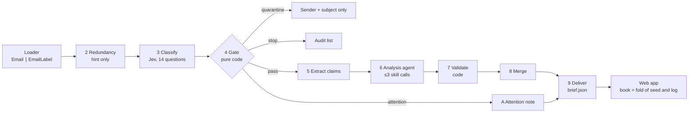
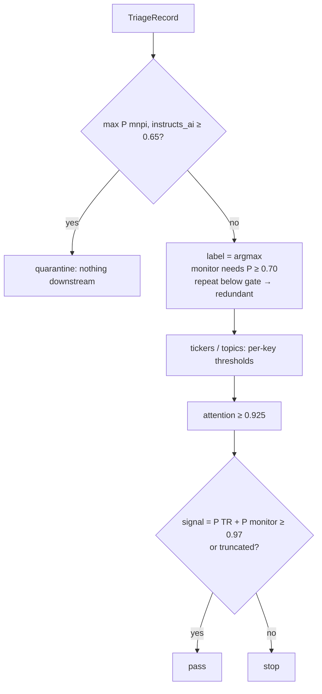
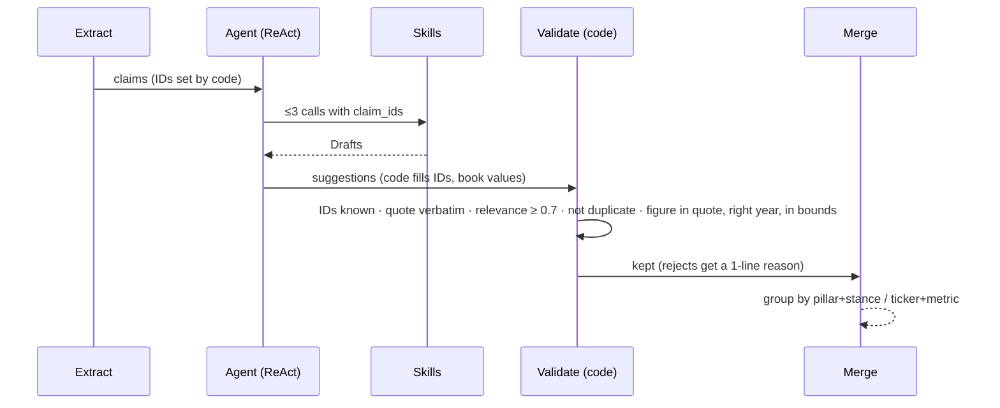
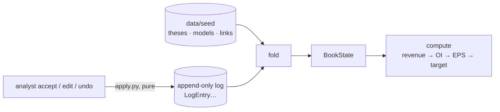
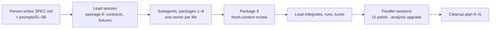

# Debrief reference

A crib sheet for the case-study debrief.

- **Each component section has the same parts:** prompts, reasoning, spec, design choices, features, and likely questions.
- **`#N`** is a row in `DECISIONS.md`.
- **Numbers** come from the committed `data/out/<set>/eval.json` and `metrics.json`. Quote these, not #67.
- **Deeper reading:** how the evals are built, and the feedback-loop design, are in [EVALS_AND_FEEDBACK_LOOP.md](EVALS_AND_FEEDBACK_LOOP.md).
- **Metric definitions:** [Glossary](#glossary-testing-metrics), directly below the results table.

---

## 0. Quick reference

**Pitch.** An analyst gets 100–300 emails a day. The system:

- triages each email;
- checks the relevant ones against a five-name long/short book (AMZN, NVDA, MSFT, AAPL, GOOGL);
- leaves a few suggestions, each backed by quotes;
- shows that everything else is safe to ignore.

**Models recommend, code validates, the analyst decides.**

**Results** (tuned thresholds, criteria `0b34df14dec8`)

| Measure | day_1 (288) | day_2 (300) |
|---|---|---|
| Gate recall (TR passed) | 0.833 | 0.667 |
| Monitor gate recall | 0.867 | 0.938 |
| Gate reduction | 0.774 | 0.787 |
| Signal accuracy (3-class) | 0.882 | 0.867 |
| Triage accuracy (5-class) | 0.681 | 0.673 |
| Ticker micro-F1 | 0.752 | 0.837 |
| Attention P / R | 0.818 / 0.947 | 0.810 / 0.850 |
| Topic micro-F1 | 0.113 | 0.115 |
| Repeat flags / precision | 54 / 0.111 | 43 / 0.070 |
| Quote faithfulness · stray suggestions | **1.0 · 0** | **1.0 · 0** |
| Cost (Haiku 5.5, excl. Jev) · p95 latency | $0.34 · 31 s | $0.43 · 38 s |

### Glossary: testing metrics

#### Building blocks

| Term | Meaning |
|---|---|
| **Precision** | Of what the system flagged, the share that was right. Low precision means noise for the analyst |
| **Recall** | Of what should have been flagged, the share the system caught. Low recall means missed signal |
| **F1** | 2·P·R / (P + R): one number that balances precision and recall |
| **Micro vs macro F1** | Micro pools every decision, so common tickers dominate. Macro averages per class, so rare tickers count equally |
| **Signal score** | P(thesis_relevant) + P(monitor) from Jev. The gate passes an email when the score ≥ 0.97 |
| **Signal / redundant / noise** | The 3-class view: signal = TR + monitor, noise = low_value + irrelevant |
| **Miss** | One email where a measure went wrong, with what was expected and what came out. Every miss is listed in `eval.json` |
| **Quarantine rule** | A quarantined email counts as a miss on every label measure, so quarantine can't improve a score |

#### Measures in `eval.json` (current system)

| Metric | What it measures | Why it matters / what to say |
|---|---|---|
| **Gate recall** | Share of TR emails that pass the gate | The most important number: a stopped TR email is never analyzed. 0.833 / 0.667 (W1) |
| **Monitor gate recall** | Same, for monitor emails | Second-tier signal. 0.867 / 0.938 |
| **Gate reduction** | Share of emails stopped before analysis | Analyst load saved. About 77–79%. No target, since it trades off against recall |
| **Signal accuracy** | Correct on the 3-class view | The product's headline accuracy. 0.882 / 0.867 |
| **Triage accuracy** | Exact match on all 5 labels | Lower (about 0.68), mostly low_value vs irrelevant mix-ups, which don't matter |
| **Confusion table** | Corpus label × pipeline label counts | Shows the costly error: TR → redundant (3 a day) |
| **Ticker F1** | Micro-F1 on which of the 5 companies are affected | Drives which pillars get compared. 0.75 / 0.84 |
| **Topic F1** | Micro-F1 on macro, sector, government, other | About 0.11; poorly calibrated, not investigated (W6) |
| **Attention precision / recall** | The "needs a human" flag | 0.82 / 0.95 on day_1. Recall matters more: a missed meeting request is costly |
| **Repeat flagged / precision** | Number of repeat flags; share labeled redundant | Precision about 0.1, so the flag is only a hint. No recall, because there's no ground truth (W3) |
| **Stray suggestions** | Suggestions backed only by noise emails | 0 on both days. Shows the gate and validation keep junk out |
| **Quote faithfulness** | Share of quoted sections found verbatim in the email | 1.0. Enforced by code, so it confirms the guardrail works rather than measuring quality |
| **Email type accuracy** | Jev's email type vs the corpus | Display only. 0.79 / 0.84 |
| **Meetings share** | Share of emails that are meetings, events or newsletters | Descriptive check of the corpus mix |
| **Note / suggestion / new-thesis review** | Share of items a person marked correct on every check | Empty: the sheets haven't been filled. The only quality measure for the analysis stages |
| **Cost per email, p95 latency** | From `metrics.json` | About $0.001 per email excluding Jev; p95 31–38 s. Cached reruns cost $0 |

#### Tuning and method terms

| Term | Meaning |
|---|---|
| **Fit / validation split** | The tuning set is split 2/3 to fit thresholds and 1/3 to check them. The test days are never used for fitting |
| **Holdout** | Data used only to judge a change, never to make it. Reused too often, it stops being one (M2) |
| **In-sample** | A score measured on the data used to fit. Gate recall there is 1.0 by construction (M1) |
| **Keep rule** | A criteria edit is kept only if it fixes ≥ 2 fit emails, breaks none, and doesn't lower validation signal accuracy |
| **Wilson CI** | A confidence interval for a proportion that holds up at small n. For example, 0.833 on 30 emails is [0.66, 0.93] |

#### Terms from the feedback-loop design

| Term | Meaning |
|---|---|
| **G1–G6 (invariants)** | Must hold exactly: quote faithfulness 1.0, no quarantined body shown, no labels in prompts, no book in Jev, regression suite 100%, no model-assigned IDs |
| **P1 / P2: estimated gate recall** | Recall on real mail, estimated from a random audit of stopped emails, weighted by inverse propensity |
| **Propensity / IPW** | Propensity is how likely an email was to be sampled for audit. Inverse-propensity weighting reweights the sample so the estimate is unbiased |
| **P3: analyst load** | Emails passed plus suggestions shown per day |
| **P4: suggestion precision** | (accept + edit) ÷ (accept + edit + dismiss for an error) |
| **P5: useful-but-low** | Dismissed as "not material" or "already known": correct but below the bar |
| **P6: contradiction recall** | Share of contradicting evidence surfaced. Guards against the loop learning to hide bad news |
| **P7: attention precision** | respond ÷ (respond + reject) |
| **P8: mattered rate** | "This mattered" clicks per 100 stopped emails browsed: the analyst flagging a gate miss |
| **Non-inferiority margin** | How much a metric may drop while another improves, for example −1 pt on P1 |
| **Conformal threshold** | A threshold picked from positive scores so a new positive passes with a stated probability, for example ≥ 98% |
| **Calibration** | Whether a 0.8 probability is right 80% of the time |
| **Brier score** | Mean squared error of the probabilities; lower is better |
| **ECE** | Expected calibration error: the average gap between predicted and actual rates across probability bins |
| **Cohen's κ** | Agreement between two analysts beyond chance. Below 0.6 means the label definition is unclear |
| **McNemar's test / paired bootstrap** | Ways to compare two versions on the same emails, so the comparison isn't noise |

**The build.**

- 344 offline tests, run in about 9 s.
- `mypy --strict` is clean.
- 64 commits over Oct 8–12.
- 108 DECISIONS rows.
- 14 drafts in REVIEW.md, none of them reviewed yet.

**Weaknesses to raise yourself.** Later sections point back here rather than repeat them.

1. **W1 – Gate recall is below target.**
   - Cause: the pass threshold (0.97) is set at the lowest thesis_relevant score in the fit split, with no margin.
   - Fix: add a margin, use recall-weighted fitting, or get more tuning data.
2. **W2 – The labels are synthetic.** One generator wrote both the emails and their labels, so the scores measure consistency, not performance on real mail.
3. **W3 – Repeat precision is low (0.07–0.11).** There's no `redundant_of` ground truth, so the thresholds are fixed. That's why the repeat flag is only a hint.
4. **W4 – The day_1 corpus was hand-edited (#85, #87).**
   - 11 emails were replaced and 12 removed.
   - The edits are disclosed. They added test inputs and weren't made to raise a score.
5. **W5 – No generated draft has been reviewed.** Compliance sign-off on the MNPI quarantine rule is still open.
6. **W6 – Topic F1 is about 0.11.** Jev's topic probabilities are poorly calibrated, and this wasn't investigated.

---

## 1. Spec and synthetic corpus

**Prompts.**

- **`SPEC.md`** (1,471 lines) is the source of truth. It has the stage table, seven design rules, the data contracts, the build order and a default for each open decision.
- **`KICKOFF.md`** tells the lead agent to:
  - read the spec whole;
  - log choices the spec leaves open;
  - keep the transcripts;
  - never generate emails.
- **`docs/corpus_documentation/synthetic_data_prompt.md`** specifies:
  - the label mix (TR/monitor/redundant/low_value/irrelevant) as 10/15/10/35/30;
  - 15–25 attention emails per 300;
  - at least 20% meetings and events;
  - planted hard negatives;
  - "don't infer relevance from sender prestige or length".

**Reasoning.**

- **Labels are planned before any text exists.** `generate_email_plan.py` draws the labels for each slot with fixed seeds, then the LLM writes an email to fit them. This gives exact, reproducible distributions.
- **The corpus contains no book.** Triage can be scored automatically, but book impact has to be reviewed by a person.
- **The loader enforces label isolation.** It splits each row into `Email` and `EmailLabel`, and only the loader, evals and tuning read labels. Tests check that no label field reaches a prompt.

**Spec.**

- **Sets:** day_1 (288), day_2 (300), tuning (100).
- **Row fields:**
  - input: `email_id`, `sender`, `sender_email`, `subject`, `body`;
  - label: `triage`, `additional_labels`, `affected_tickers`, `human_attention`, `reason`;
  - generation-only: `email_type`, `systemic`, `angle`, `day`.
- **The loader:**
  - normalizes spellings (GOOG → GOOGL);
  - assigns `received_at` in file order;
  - validates every row with Pydantic;
  - reports the distribution against targets;
  - hashes rows to find duplicates and keep the tuning set separate from the test days.
- **Tuning split:** 2/3 fit and 1/3 validation, stratified, seed 13.

**Design choices.**

| Choice | Why | Cost |
|---|---|---|
| Labels planned before generation | Exact distributions | One generator's judgement (W2) |
| Bodies kept exactly as in the corpus (#46) | One source for verbatim quote checks | No cleaning step |
| Email types cut from 18 to 11 (#45) | The types overlapped | The generation scripts no longer reproduce the files |

**Likely questions.**

- **Is the corpus reproducible?** The plans are. The text isn't: it was generated at temperature 1.0 and later edited in place.
- **What are its limits?**
  - Emails are short (about 250 words).
  - There are only two test days.
  - There's no repeat check across days.
  - There are few safety cases.

---

## 2. Triage: redundancy, classify, gate

**Prompts.**

- **`instructions/jev_questions.md`** asks 14 questions:
  - `triage` (one of 5 labels);
  - 5 × `affects_{ticker}`;
  - `human_attention`;
  - 4 × `topic_*`;
  - `email_type` (display only);
  - `possible_mnpi` and `instructs_ai`, the safety questions.
- **`criteria/*.md` (11 files):**
  - a fixed `Definition` for each label, plus `Rules` (at most 12 per file, one sentence each);
  - the loader rejects any book ID in a criteria file;
  - a hash of the files sets the criteria version, which is stamped on every record and included in the cache key.
- **Rule edits:** #39 and #92 sharpened the boundary between monitor and thesis_relevant. Fit signal accuracy rose from 0.552 to 0.866.

**Reasoning.**

- **Jev only returns probabilities.** Code applies every threshold, so the gate can be audited and tuned without re-prompting.
- **Jev never sees the book.** Labels reflect the desk's definitions, not its current views.

**Spec.**

- **Redundancy:**
  - chunked mean embeddings from `bge-small-en-v1.5`;
  - cosine similarity against earlier emails the same day;
  - a rapidfuzz match on subjects;
  - flag when cosine ≥ 0.85, or when cosine ≥ 0.75 and the subject match ≥ 0.6 (thresholds fixed, #4);
  - `redundancy.json` lists flagged emails only and saves no vectors.
- **Classify:**
  - Jev sees only the sender, subject and body;
  - bodies over 32k tokens are trimmed and marked `truncated`;
  - `jev-1.13.0` is pinned (#11).
- **Tuned thresholds:**
  - ticker thresholds run from 0.395 (GOOGL) to 0.705 (NVDA);
  - topic thresholds run from macro 0.07 to government 0.875.

**Design choices.**

| Choice | Why | Cost |
|---|---|---|
| Repeat flag is only a hint; it can relabel only stopped emails | Embedding similarity is weak evidence | Flags many emails on the same topic (W3) |
| Reasons for decisions are written by code | Traceable, and none are invented | Terse |
| Quarantine runs first | A suspect body reaches no model and no screen | A false positive can't be inspected |
| Signal = P(TR) + P(monitor) | Jev splits probability between these two adjacent labels | A zero-margin threshold generalizes poorly (W1) |
| TypeSafe SDK rather than DSPy (#9) | DSPy bakes criteria into types, so every edit means a rebuild. The SDK maps 1:1 to the files and reports tokens | No ReAnchor; thresholds are fit by code sweep |

**Likely questions.**

- **How do you handle prompt injection?**
  - The safety questions quarantine an email at 0.65, before anything else runs.
  - Later prompts wrap the body as data.
  - All output is validated.
- **Why a monitor minimum of 0.70?** It's the smallest value that reaches the plateau in fit signal accuracy without losing correct monitor labels.
- **How is a rule change accepted?** Through `criteria_check`: the change must fix at least 2 fit emails, break none, and not lower validation accuracy. #39 and #92 each broke one email and were kept by explicit decision.
- **What are the known gaps?**
  - The "no" side of each yes/no question has no description (#10).
  - The SDK sends no system preamble (#32).
  - Jev's cost isn't tracked.

---

## 3. Analysis: notes, extraction, agent, validation, merge, delivery

**Prompts.**

| File | Returns | Key rule |
|---|---|---|
| `instructions/attention_note.md` | `NoteDraft` | Summary, action, and a deadline only if the email states one. No investment view |
| `instructions/extract_claims.md` | `ClaimDraft[]` | Verbatim quote, tickers, metric/period/value. `[]` if nothing qualifies |
| `instructions/analysis_agent.md` | tool loop | `alter_existing_thesis` first, `revise_projections` only for complete figures, `spawn_new_thesis` only if no pillar fits. At most 3 calls |
| `skills/alter_existing_thesis.md` | `ExistingThesisDraft` | Stance supports/contradicts/none, relevance bands, strength 1–3 |
| `skills/spawn_new_thesis.md` | `NewThesisDraft` | At most one per ticker |
| `skills/revise_projections.md` | `ProjectionDraft` | Give the stated value as is; never compute (#82) |
| `instructions/verify_agent.md` | `VerifyDraft` | Confirmed, contradicted or not_found; at most 4 tool calls |

All of these were generated from `prompts/04–06`. Bodies are wrapped as data, and the voice is the analyst's (#83).

**Reasoning.**

- **Each call has one narrow job.** Extraction finds claims, skills judge them against the book, and code enforces the contracts.
- **Hallucination is controlled by checks after each call,** not by trusting the prompt.

**Spec.**

- **Model:** Haiku 5.5 through OpenRouter at temperature 0, with retries on 429/5xx.
  - `LenientJSONAdapter` repairs fenced or bare JSON.
  - A reply that won't parse is retried twice (#63, #65).
- **Extract:** writes `<email>.c<n>`.
  - A flagged repeat gets the earlier email as context.
  - Claims whose quote already appears in that earlier email are dropped (#40).
- **Analyze:**
  - code chooses the candidate pillars;
  - stance=none is dropped;
  - the top 2 by relevance are kept;
  - skills never see position size or conviction.
- **Validate:** the first failing rule rejects the suggestion. Figures that fail the bounds or period checks are dropped while the suggestion is kept.
  - Monitor-only evidence is capped at strength 1.
  - A suggestion with no TR or monitor email behind it gets a "second look" mark.
- **Merge:**
  - `<pillar>.<stance>`: the strongest version wins and assumptions are pooled;
  - new theses merge at cosine ≥ 0.8;
  - projections merge on (ticker, metric, period, value).
- **Deliver:** ranked by position size, then strength, then signal.
  - Alerts fire when a wrong-if condition is met on a position ≥150 bps, or when attention ≥ 0.8.
  - At most 3 alerts a day.
- **Verify:** keeps only sources whose quote appears verbatim in a tool result. With no sources left, the verdict is not_found.

**Design choices.**

| Choice | Why | Cost |
|---|---|---|
| Model output parses into Draft types; code builds the stored types | No value a model supplies is trusted | Two schema layers |
| Code assigns IDs and book values | No invented pillars or numbers | The model must cite the IDs it was shown |
| At most 3 skill calls | Bounded cost and latency | Partial coverage of emails touching many tickers |
| Suggestions come from skill results, not the agent's text | The agent can't slip one in | The analyst never sees the agent's reasoning |
| Each email processed in isolation (#54C) | One bad reply doesn't stop the stage | That email is logged as failed |

**Likely questions.**

- **How do you control hallucination?** Verbatim quotes, figures that must appear in the quote (#54), and IDs and values assigned by code. Quote faithfulness was 1.0 with 0 stray suggestions.
- **Why not fuzzy-match quotes?** Paraphrases would pass. Whitespace is the only difference allowed.
- **Why use an agent?** The spec has it choose the skills, so adding a skill doesn't grow the prompt. Code still limits its scope.
- **What failure modes did you see?**
  - Haiku replied with fenced JSON and its own tool markup.
  - OpenRouter errors sank a Sonnet rerun (#91).
  - Figures for the wrong fiscal year are dropped (#34).
- **What are the limits?**
  - Relevance is self-rated by the model.
  - The merge thresholds aren't tuned.
  - Verify knows one 10-K per company.
  - The analysis stages have no measure of quality yet.

---

## 4. State layer and book

**Prompts.**

- **`prompts/01_book.prompt.md`** generated `models_draft.json`: the analyst and consensus values, the bounds, and multiples from GOOGL 21 to NVDA 32.
- **`base_figures.json`** holds real 10-K figures, extracted and checked against XBRL.

**Reasoning.**

- **The book is kept apart from the inbox.** The same inbox with a different book gives a different brief.
- **The change log is append-only, and current state is never stored.** That makes reset, undo and audit trivial.

**Spec.**

- **The book:**
  - 5 positions (stance, size, conviction 1–5);
  - 3 pillars per company;
  - 23 drivers per company.
- **Change kinds:**
  - evidence;
  - pillar added, edited or removed (#69);
  - driver updated;
  - conviction changed;
  - projection noted (#82).
- **Fold:**
  - walks the log backwards, so a reversing entry cancels its target;
  - applies what survives to deep copies of the seed;
  - IDs of removed pillars are never reused.
- **Compute:**
  - revenue = Σ base × (1 + growth)
  - EPS = revenue × margin × (1 − tax) / shares
  - target = EPS × multiple
  - It runs on both the analyst and consensus figures. Capex doesn't feed into EPS.
- **Conviction review:** raised when net contradicting strength reaches 4. The analyst picks the new value.

**Design choices.**

| Choice | Why | Cost |
|---|---|---|
| Event-sourced log | Undo, reset and audit; the seed is never mutated | The fold reruns on every request |
| Undo by reversing entry | History is never rewritten | No redo; a dismissal can't be undone (#41) |
| Pure `compute` | Tested by hand; reused by the skills and the UI | A one-year model |
| Modeled year = last reported year + 1 (#14) | The same rule for every company | FY2027 figures are rejected for three companies |

**Likely questions.**

- **Can a model change the book?** No. Only an analyst accept or a manual action writes a `LogEntry`.
- **Which numbers are real?**
  - Real, from the 10-Ks: base revenue, tax and share counts.
  - Synthetic: the drivers, multiples and street targets.
- **Does the batch pipeline see accepted changes?** No. It analyzes against `fold(seed, [])`.

---

## 5. Evals, tuning, caching, tests

For metric definitions, the tuning algorithm, error analysis and the weaknesses in the method, see [EVALS_AND_FEEDBACK_LOOP.md](EVALS_AND_FEEDBACK_LOOP.md), Part A.

**Prompts.** None. There's no LLM judge. Label measures are computed in code, and the quality reviews are CSV sheets a person fills in (still empty).

**Reasoning.**

- **Grading is deterministic.** The system never grades its own work.
- **The keep rule exists because the tuning set is small.** It has 9 TR emails, so a single email is noise.

**Spec.**

- **Cache key:** `sha256(program, criteria version, namespace, payload)`, one JSON file per entry, about 3,083 entries.
  - Pruning by trace took it from 5,802 to 2,230 entries with 0 misses on replay (#101).
- **Monitoring:**
  - `CallRecord` (tokens, cache hit, latency) and `StageTiming`, rolled up into `metrics.json`;
  - IDs and counts only, never text.
- **Tests:** 344, using `FakeChat`, `FakeEmbedder`, `FakeJev` and stage-file fixtures. No test needs a key or the network.

**Design choices.**

| Choice | Why | Cost |
|---|---|---|
| Tune on the tuning set only | The test days stay clean | Small n, so the thresholds are noisy (W1) |
| Commit the cache | Deterministic replay at $0 | About 15 MB, and a bad reply replays until purged (#64) |
| Clients injected as arguments | Tests stay offline | A client in every signature |
| One `cached_call` path (#12) | Caching and metering can't drift apart | Depends on a deprecated DSPy API (pinned at 3.4.0) |

**Likely questions.**

- **What does a run cost?** About $0.001 per email, excluding Jev. A cached rerun costs $0.
  - `metrics.json` shows no classify stage; the run was probably started `--from extract`.
- **Is it reproducible?** Yes: every input is part of the cache key. Changing the criteria or a prompt changes the key, so those calls run live.

---

## 6. Web app and notebook

**Prompts** (transcripts 02 and 03):

- build the front end;
- plain-English labels, with scores hidden behind "View scores" (#62, #68);
- a needs-attention tab (#59);
- sort and filter for requests (#74, #75);
- an explicit description of each suggested change (#94);
- a glossary (#123);
- side-by-side contradictions;
- an inbox-style search.

The key permission was #60: UX may depart from the spec, backend contracts may not.

**Reasoning.**

- **The app only re-presents committed stage files,** so pages are deterministic and cheap to serve.
- **A quarantined body never reaches a screen,** and the UI never shows a model making a decision.

**Spec.**

- **Stack:**
  - FastAPI, Jinja2 and HTMX 2.0.4, with no JS build (#56);
  - one Docker container;
  - POST routes return HTMX fragments, or a 303 redirect without HTMX.
- **Pages:**
  - brief, summaries, review queue (A/D/J/K keys), suggestion, compare, attention (list or calendar), inbox and email, book and company;
  - under the hood: audit, criteria, live, eval, monitor.
- **The Live tab** runs the real stage functions on one email and shows a trace for each stage. If a step fails, only the type of the exception is shown.
- **The notebook** replays three emails at 0 tokens: a thesis change, an attention note, and an email stopped at the gate (#66).

**Design choices.**

| Choice | Why | Cost |
|---|---|---|
| Server-rendered with HTMX | One Python process; links work without JS | Less interactivity |
| Analyst accepts, edits or dismisses; nothing sends mail | Models never decide | Every change needs an analyst action |
| Scores hidden by default | Readability | Less transparency at a glance |

**What a PM sees:**

1. **Brief:** ranked changes, new theses, items to watch, contradictions, alerts.
2. **Review:** what changes if you accept (EPS and target recomputed), the reasoning, the quotes highlighted in the email, and accept/edit/dismiss/verify.
3. **Needs attention:** requests grouped by reply-by date.
4. **Inbox:** `from:`, `label:` and `after:` search.
5. **Book:** EPS and target against consensus and the Street, with editable pillars.
6. **Under the hood:** audit with "This mattered", criteria, live, eval, monitor.

**Likely questions.**

- **Why not React?** One deployable Python process, with partial updates from HTMX.
- **Is it secure?** Jinja autoescapes, highlighting escapes the email body first, and API keys live only in environment variables.

---

## 7. How it was built with AI

**Prompts.**

- **Corpus:** "generate two sets of 300 emails… first script the target labels". Corrected twice so the output carries every label needed for grading.
- **Build:**
  - `/init`, then "follow the spec", "add monitoring", "run kickoff.md, use subagents";
  - then targeted steers:
    - the monitor/TR boundary (#39);
    - output cleanup (#45–52);
    - model choices (#55, #77, #91);
    - prompt rewrite (#78–84);
    - classification rules (#92);
    - skeptical reading of monitor emails (#96–98).
- **Subagent briefs:**
  - each brief names the files the agent owns, the spec sections to read, numbered steps, and the tests that mean done;
  - `_common.md` freezes the contracts and requires caching and monitoring;
  - the same file forbids labels in prompts and commits by subagents, and requires `mypy --strict`.
- **Packages:**
  - 1: skills
  - 2: loader
  - 3: redundancy
  - 4: classify and gate
  - 5: attention
  - 6a: extract, agent and verify
  - 6b: validate and merge
  - 7: state and web
  - 8: evals
  - 9: review. It found real bugs, fixed in #43 and #54.

**Reasoning.**

- **Spec first,** because agents with no memory need contracts and done-when tests.
- **Frozen contracts and one owner per file,** so packages could run in parallel.
- **DECISIONS and REVIEW** give an audit trail and keep generated drafts apart from vetted content.

**Timeline.**

- **Oct 8 (14 commits):** foundation, all stages, the app and evals, tuning.
- **Oct 9 (43):** final runs, the notebook, the parallel UI and analysis branches, rule changes, cache pruning.
- **Oct 12 (7):** cleanup.

**Key decisions:**

- #9: SDK rather than DSPy.
- #6/#7: all calls through OpenRouter; model IDs only in `.env`.
- #12: one cached path for every call.
- #37: quarantine at 0.65 with the MNPI question refocused (the old wording quarantined 8 of 10 fixtures).
- #38: every threshold defined once.
- #39/#92: criteria rules.
- #46–49: simpler outputs.
- #54: a figure must appear in the quote.
- #60: UX freedom.
- #67: scores reported, never tuned on.
- #85/#87: corpus edits.

**Waiting for a person (REVIEW.md):**

- 14 drafts: seed files, 11 criteria files, 2 skills, 5 instructions, 2 tool files.
- Flags: MNPI sign-off, and Jev's lean toward `monitor`.
- Gap: `skills/revise_projections.md` isn't listed.

**Likely questions.**

- **How much did AI write?** Nearly all the code, tests, drafts and corpus. You wrote the spec and directed every change in behaviour; DECISIONS has dozens of "Person's instruction" rows.
- **How did you verify the AI's work?**
  - 344 tests and `mypy --strict`;
  - verbatim quote checks in code;
  - an independent review subagent;
  - held-out evals;
  - reading the output in the UI.
- **What did you decide yourself?**
  - providers and models;
  - the MNPI rule;
  - the monitor/TR boundary;
  - the corpus edits;
  - UX freedom;
  - simpler outputs.
- **Why subagents?** Parallel builds against frozen contracts, plus a reviewer with no stake in the code.
- **What went wrong in coordination?** DECISIONS numbers collided between sessions. Rows 120–149 were reserved for UI rows to fix it.
- **What would you do differently?**
  - Choose the model once.
  - Clear REVIEW before tuning.
  - Reserve DECISIONS numbering per session.
  - Add a threshold margin.
  - Build a larger tuning set.
- **What's the path to production?**
  - Shadow mode on real mail.
  - Compliance review of quarantine.
  - Margins on the thresholds.
  - Price and monitor Jev.
  - Repeat detection across days.
  - The feedback loop in the companion doc.
