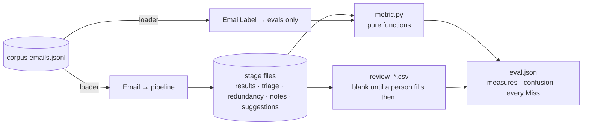
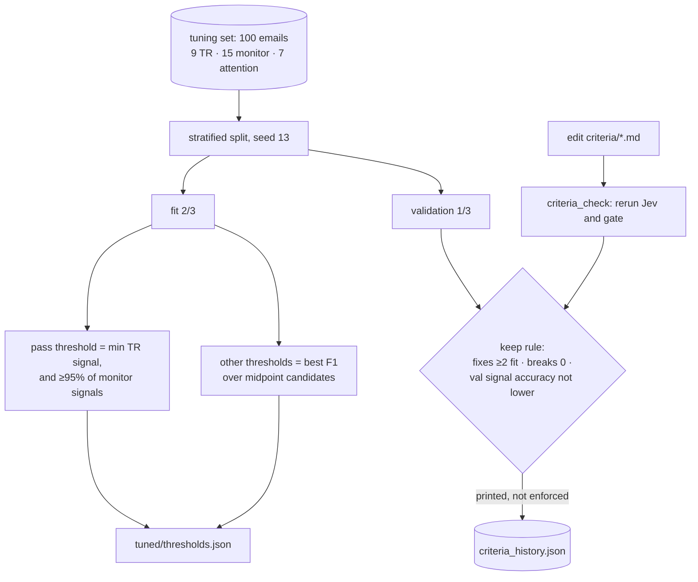
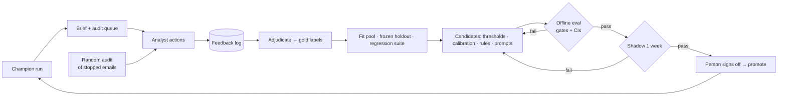

# Evals in depth, and a feedback loop

- **Part A** explains how the current evals work, taken from `src/triage_app/evals/`.
- **Part B** designs a loop that improves the system from analyst feedback. It is a design only; none of it is built.
- `#N` refers to a row in `DECISIONS.md`. W1–W6 are the weaknesses listed in [DEBRIEF_REFERENCE.md](DEBRIEF_REFERENCE.md#0-quick-reference).

---

# Part A: How the evals work

## A1. Data flow



- **Every measure returns `Score(value, misses)`.** `value` is `None` when the measure is undefined. `misses` lists each email that went wrong, with what was expected and what came out, so `eval.json` doubles as a worklist for error analysis.
- **A quarantined email counts as a miss on every label measure.** Quarantine can never improve a score.

## A2. Measures

| Key | Definition | Note |
|---|---|---|
| `gate_recall` / `monitor_gate_recall` | Labeled TR (or monitor) emails that passed / all labeled TR (or monitor) emails | |
| `gate_reduction` | Emails stopped / all emails | Analyst load; no target |
| `signal_accuracy` | Correct on 3 classes: signal, redundant, noise | Hides low_value vs irrelevant mix-ups (both are noise) |
| `triage_accuracy` | Exact match on all 5 labels, plus a confusion table | |
| `ticker_f1`, `topic_f1` | Micro-F1 = 2TP / (2TP + FP + FN) | Common tickers dominate |
| `human_attention_precision` / `_recall` | Standard precision and recall on the attention flag | |
| `repeat_flagged`, `repeat_precision` | Number of flags; share of flagged emails labeled `redundant` | No recall (#4) |
| `stray_suggestions` | Suggestions whose every linked email is noise or redundant | A count |
| `quote_faithfulness` | Sections found verbatim / all sections | Stage 7 already enforces this, so 1.0 confirms enforcement, not quality |
| `email_type_accuracy`, `meetings_share` | Jev's email type vs the corpus; share of meeting-like emails | Display only |
| `*_review` | Rows where every applicable check is yes / filled rows | `None` until a person fills the sheet |

**Targets** (`thresholds.EVAL_TARGETS`): gate recall 0.85, signal accuracy 0.80, ticker F1 0.75, attention recall 0.85. Measures without a target are reported only.

## A3. Tuning and the criteria check



- **Fixed, not tuned:** the redundancy and quarantine thresholds. Quarantined emails are left out of every sweep (#36).
- **In-sample gate recall is 1.0 by construction (W1).** With about 6 TR emails to fit on and 3 to validate on, one email moves validation recall by 33 points.

**History.** Eight criteria versions were scored within about 33 minutes on Oct 9.

| Version | Fit signal accuracy | Validation signal accuracy | Validation gate recall | Labels changed |
|---|---|---|---|---|
| f16e16cf314d (start) | 0.552 | 0.758 | 1.0 | – |
| 1f44a2faac8e (#39) | 0.866 | 0.939 | 1.0 | 41 |
| 7799eaeeab0e | 0.881 | 0.970 | 1.0 | 7 |
| 7ba007692002 | 0.821 | 0.909 | 1.0 | 19 |
| e6870cf92be0 | 0.881 | 0.970 | 1.0 | 19 |
| 1b5d52a65e1f | 0.881 | 0.939 | 1.0 | 8 |
| **0b34df14dec8 (committed)** | 0.895 | 0.939 | 1.0 | 4 |
| 2960ba9d8d73 (not kept) | 0.895 | 0.939 | **0.667** | 5 |

## A4. Where the errors are

| Corpus label → pipeline label | day_1 | day_2 |
|---|---|---|
| TR → TR | 24 / 30 | 22 / 27 |
| TR → redundant | 3 | 3 |
| TR → monitor | 3 | 1 |
| low_value → irrelevant | 52 / 105 | 50 / 99 |
| low_value → redundant | 19 / 105 | 17 / 99 |
| low_value → signal (false positive) | 7 | 7 |

- **The costly error is TR → redundant.** The email is stopped and never analyzed.
- **Low_value vs irrelevant drives most triage-accuracy misses,** but it doesn't matter to the product, since both are noise.
- **The gate stopped 13 TR emails, plus 1 quarantined on day_2:**
  - 10 of the 13 scored 0.93–0.96, just under the 0.97 threshold (W1).
  - **For 7 of the 13, Jev's top label was TR.** The gate ignores the label, because it reads the summed signal score.
  - **A cheap fix:** "Jev's top label is TR → pass". It would recover those 7 at a cost of 13 extra passed emails over two days, lifting gate recall to about 0.90 on day_1 and 0.85 on day_2.
- **Topic F1:** 285 of 288 emails mismatch. Investigate before quoting it (W6).

## A5. Weaknesses in the method

| # | Weakness | Fix |
|---|---|---|
| M1 | In-sample gate recall is 1.0 by construction, and validation has only 3 TR emails | A threshold with a recall guarantee (B5.1); more positives |
| M2 | One validation split reused across 8 versions has stopped being a holdout | A fresh holdout per release, with a limit on evaluations |
| M3 | No confidence intervals: day_1 0.833 is [0.66, 0.93] and day_2 0.667 is [0.48, 0.81] (Wilson 95%), so they overlap | Report CIs and set a minimum n |
| M4 | The analysis stages have no measure of quality: the review scores are `null`, and quote faithfulness and stray count are guardrails | Accept/dismiss feedback (Part B) |
| M5 | The keep rule is only advisory, and it was overridden twice | Enforce it in CI, with waivers recorded in DECISIONS |
| M6 | TR and monitor misses are weighted equally | Cost-weighted recall |

---

# Part B: A feedback loop

## B1. Principles

1. **People label; models never grade themselves.**
2. **Code proposes; a person promotes.** Every change is versioned, shadowed and reversible.
3. **The invariants are hard gates:**
   - quote faithfulness 1.0;
   - no labels in prompts;
   - no quarantined body shown anywhere;
   - Jev never sees the book.
4. **Measure what was hidden.** Feedback only covers what was shown, so recall needs deliberate sampling.
5. **Optimize for correct, not agreeable.** Never learn to suppress evidence that contradicts the analyst.

## B2. The loop



**Cadence:** collect feedback daily; adjudicate and evaluate weekly; shadow for at least a week; rotate the holdout quarterly.

## B3. Signals

Most of the hooks already exist. The new pieces are reason codes on dismiss, relabeling, a persistent log, and the audit sample.

| Signal | Labels | Strength · bias |
|---|---|---|
| **This mattered** on a stopped email | A gate false negative | Strong · only on emails the analyst chose to browse |
| **Audit verdict** (new: 10 stopped emails a day, judged blind) | Unbiased gate recall | Strong · unbiased |
| **Relabel** (new) | Gold triage label | Strong · only on emails the analyst opened |
| **Accept / Edit** | The suggestion was correct; an edit shows miscalibration | Strong · open to confirmation bias |
| **Dismiss + reason code** | A typed negative | Strong once typed |
| **Respond / Reject** on a request | Attention precision | Medium |
| **Seen this already** (new) | Repeat pairs, giving ground truth for redundancy | Medium |

**Dismiss codes**, each owned by one stage:

| Code | Owner |
|---|---|
| `wrong_pillar`, `wrong_stance` | Analysis skill |
| `not_material` | Relevance and strength calibration |
| `already_known` | Novelty against the book |
| `quote_doesnt_support` | Extraction |
| `bad_source` | Criteria rules |
| `duplicate` | Merge |
| `wrong_figure` | Projection validation |

**Contract** (new in `schema.py`):

```
FeedbackEvent(id, at, analyst_id, target_kind, target_id, email_ids, action, reason_code,
              corrected_label, corrected_tickers, corrected_strength,
              versions{program, criteria, thresholds, prompts, models}, shown_rank, propensity)
```

- The log is append-only and kept in a database.
- Events hold IDs and codes only; free-text comments are stored apart from them.
- Events on quarantined emails are kept for audit but never enter a data pool.

## B4. From feedback to datasets

- **Mapping actions to labels:**
  - `mattered` or `audit_yes` → should pass;
  - `relabel` → that label;
  - `accept` → correct;
  - `dismiss(wrong_*)` → incorrect;
  - `not_material` and `already_known` → correct but below the bar, never "wrong".
- **Confidence:**
  - relabel or audit: 1.0;
  - accept or a coded dismiss: 0.9;
  - respond or reject: 0.6.
- **Conflicts** go to a weekly adjudication queue. Each week 20 items are labeled by two analysts; if Cohen's κ < 0.6 on a label, its *definition* needs a person's fix.

| Set | Contents | Rule |
|---|---|---|
| Fit pool | Gold labels up to week t−1 | Free to use |
| Frozen holdout | Blind audit sample from week t | Used only to promote; ≤3 evaluations, then rotated |
| Regression suite | Every past fix and reported miss, plus the fixtures | Must stay at 100%; append-only |
| Synthetic corpus | day_1, day_2, tuning | Smoke test only |

Datasets are split by time, never randomly, to avoid leaking information across a period.

## B5. Methods, from lowest to highest risk

| # | Method | How | Kept if |
|---|---|---|---|
| 5.1 | **Threshold with a recall guarantee** | Set the threshold at the ⌊α(n+1)⌋-th lowest positive score (α = 0.02 for TR, 0.05 for monitor), minus a 0.01 margin. Add "Jev's top label is TR → pass" (A4). With too few positives for the guarantee, keep the current threshold | The lower bound of P1 ≥ target and the load P3 stays within budget |
| 5.2 | **Calibration** | Isotonic regression from Jev's P(signal) to gold labels, fit on the fit pool | Brier score and ECE improve, and P1 is no worse |
| 5.3 | **Criteria rules** | Cluster misses by (expected → got) and embedding, then a person writes a rule, or a model proposes one from fit-pool *summaries* (a person opts in, overriding SPEC default #4). Loader checks apply | ≥ max(2, 2% of the cluster) fixes, 0 regressions, fit accuracy down ≤ 0.5 pt, then the holdout. Retire rules that do nothing |
| 5.4 | **Prompt and skill edits** | From clusters of dismiss codes. Replay past emails through the cache and match new suggestions to old ones by (pillar, stance) | Accepted-recall ≥ 0.95, dismissed suppression up ≥ 10 pt (CI > 0), new outputs reviewed by a person |
| 5.5 | **Few-shot examples** | 3–5 accepted examples from the fit pool, balanced by stance, without size or conviction | Same as 5.4 |
| 5.6 | **Model swap** | A pinned ID; a silent vendor change counts as a swap | Every primary metric at least as good, and within the cost budget |

Fine-tuning Jev and changing label definitions are out of scope without a person's sign-off.

## B6. Metrics

All metrics are measured on the frozen holdout, with Wilson CIs for proportions and a 2,000-resample bootstrap otherwise, and n shown.

**Tier 0. Invariants: every one must hold exactly, or the candidate is rejected.**

| ID | Metric | Required |
|---|---|---|
| G1 | Quote faithfulness | = 1.0 |
| G2 | Responses containing a quarantined body | = 0 |
| G3 | Prompts containing any `EmailLabel` or `FeedbackEvent` field | = 0 |
| G4 | Jev requests containing a book ID or view | = 0 |
| G5 | Regression suite | = 100% |
| G6 | Stored IDs not assigned by code | = 0 |

**Tier 1. Primary: no metric may get worse beyond its margin, and the targeted metric must improve.**

| ID | Metric | Definition | Target | Margin |
|---|---|---|---|---|
| P1 | Estimated TR gate recall | Σ(passed / propensity) ÷ Σ(1 / propensity) over gold TR emails | Lower 95% bound ≥ 0.95 | −1 pt |
| P2 | Estimated monitor gate recall | The same, over gold monitor emails | ≥ 0.90 | −2 pt |
| P3 | Analyst load | Emails passed plus suggestions shown per day (7-day mean) | ≤ budget | +10% |
| P4 | Suggestion precision | (accept + edit) ÷ (accept + edit + dismiss with an error code) | ≥ 0.70 | −3 pt |
| P5 | Useful-but-low | (`not_material` + `already_known`) ÷ all decided | Monitored | +5 pt |
| P6 | Contradiction recall | Gold contradicting items surfaced ÷ all gold contradicting items | ≥ P1 − 5 pt | −2 pt |
| P7 | Attention precision | respond ÷ (respond + reject) | ≥ 0.75 | −3 pt |
| P8 | Mattered rate | Mattered events per 100 stopped emails browsed | Falling | +0.5 |

**Tier 2. Diagnostics, never used to promote:**

- per-label F1 and confusion against gold labels;
- Brier score and ECE;
- ticker macro-F1;
- edit rate;
- mix of dismiss codes;
- κ;
- time to decision;
- cost and latency;
- repeat precision and recall.

**Statistical rules:**

- **Minimum n:** 30 TR emails (P1), 100 suggestions (P4), 50 contradicting items (P6). Below these, a metric reads "insufficient n" and can neither block nor justify a release.
- **Paired comparisons:** champion and challenger run on the same emails, compared with McNemar's test or a paired bootstrap.
- **One targeted metric per release,** named in its DECISIONS entry before evaluation.

**Audit sample.** Each day, 10 stopped emails are drawn, stratified by signal band:

| Signal band | Share of the sample |
|---|---|
| [0.9, threshold) | 40% |
| [0.5, 0.9) | 30% |
| [0.1, 0.5) | 20% |
| < 0.1 | 10% |

- **Propensity** = the band's share of the sample ÷ the band's share of stopped emails.
- **Labeled blind:** the analyst sees no label or score.
- **Cost:** about 3 minutes a day.

## B7. Failure points

| # | Failure | Detect | Mitigate |
|---|---|---|---|
| F1 | **Selection bias:** feedback only on what was shown, so recall decays unseen | P1 diverges from mattered counts | Audit sample with propensity weights; never fit the gate on accept/dismiss alone |
| F2 | **Exploration starvation:** an over-strict gate never gets corrected | Flat mattered rate while audit misses are high | ε = 2% of stopped emails analyzed in a labeled "Explore" lane |
| F3 | **Confirmation bias:** contradicting evidence gets dismissed, and the loop learns to hide bad news | Stance mix of shown items vs gold | P6 is a gate; acceptance never trains stance; examples balanced by stance; conviction reviews still fire |
| F4 | **Ambiguous dismissals:** "wrong" mixed up with "true but not useful" | High `not_material` share | Required codes; low-value codes never become "wrong" labels |
| F5 | **Holdout overfitting** (already seen: 8 versions in 33 minutes) | Holdout gain far above shadow gain | At most 3 evaluations per holdout, rotation, confirmation in shadow |
| F6 | **Promoting on noise** | Version churn; overlapping CIs | Minimum n, one targeted metric, margins |
| F7 | **Drift** (earnings season vs quiet weeks, new senders) | Metrics jump at period boundaries | Time-based splits; reporting per period |
| F8 | **Overfitting to one analyst** | κ < 0.6; P4 spread across analysts | Adjudication; per-analyst preferences only in ranking, never in the gate |
| F9 | **Leakage through the loop** | Prompt-log scan; import test | `FeedbackEvent` gets the same import rule as `EmailLabel`; examples only from an approved list |
| F10 | **Silent model change** | Model ID changes in the cache key; a daily canary of 20 pinned emails | Pin IDs; alert when canary output changes |
| F11 | **Rule poisoning** from email text | Person review; lint rejecting sender names in rules | Proposals made from summaries, not raw bodies; 12-rule cap |
| F12 | **Compliance and retention** | Data-retention review | IDs only; quarantined emails excluded from pools; compliance owns the policy |
| F13 | **Audit fatigue** | Audit completion < 80% for a week | Put the audit in the morning brief; P1 reads "insufficient n", which blocks releases |
| F14 | **Cost churn** | Spend per candidate in `metrics.json` | Cache replay; a token budget; candidates batched weekly |
| F15 | **Value lags acceptance** | Later outcomes vs acceptance | Add outcome labels at 30 and 90 days (source track record); until then, acceptance is labeled a proxy |

## B8. Rollout

| Phase | Build | Exit criterion |
|---|---|---|
| 0 | `FeedbackEvent`, persistent log, dismiss codes, relabel, an Eval page reading the log | 2 weeks of data, with ≥ 90% of dismissals coded |
| 1 | Audit sampler and the P1 estimator; threshold with a recall guarantee (5.1); CIs everywhere; keep rule enforced in CI | P1 reported at n ≥ 30; one threshold change promoted |
| 2 | Calibration (5.2); the criteria loop (5.3); holdout limits and rotation | One rule change promoted end to end |
| 3 | Replay eval (5.4); balanced examples (5.5); P6 gate | P4 improves while P6 holds |
| 4 | Multi-analyst κ and adjudication; outcome labels | κ ≥ 0.6 on the core labels |

**Repo fit.**

- **New modules:** `evals/feedback.py`, `evals/audit.py`, `evals/promote.py`.
- **Reused:** `criteria_check.check` and `tune.fit_thresholds` (run on the fit pool), and `cached_call` for cheap replay.
- **Thresholds:** new ones (`AUDIT_DAILY_K`, `CONFORMAL_ALPHA_TR`, `HOLDOUT_EVAL_BUDGET`, `EXPLORE_RATE`) go in `thresholds.py`.
- **Contract:** `FeedbackEvent` is a contract change, so it needs the lead and a DECISIONS entry.
